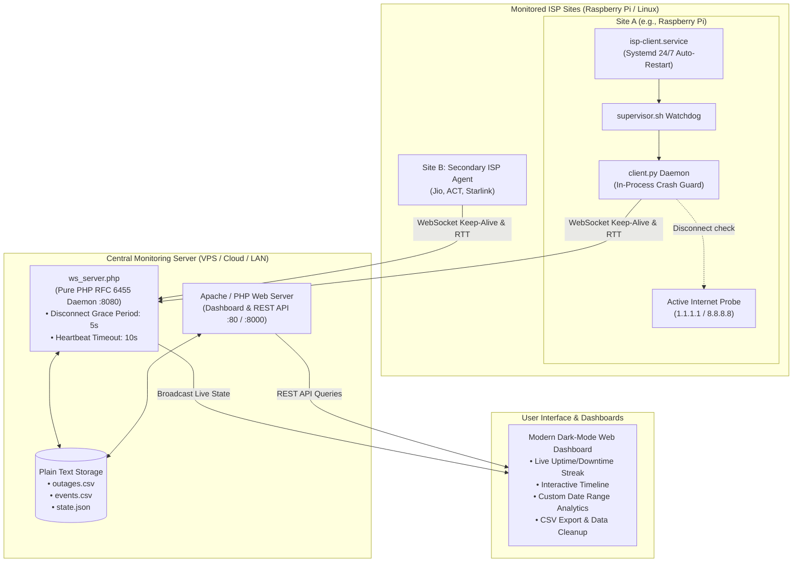

# ⚡ ISP Downtime & Reliability Monitor

[](LICENSE)
[](#)
[](#)
[](#)
[-success.svg)](#)
[](#)

A real-time, multi-ISP downtime tracking and availability monitoring system built with **PHP, Apache, WebSockets, and Python**.

Specially designed for home labs, office connections, and enterprise networks to track frequent ISP micro-outages, measure round-trip WebSocket latencies, calculate exact downtime over any historical time window (past 24h, 2 days, 3 days, 7 days, 30 days, or custom ranges), and store all records in **thread-safe plain text files (CSV & JSON) without requiring any SQL database**.

Includes an **advanced, self-recovering client daemon specially hardened for Raspberry Pi** to eliminate false `DOWN` alerts caused by client crashes, power cuts, or WiFi drops.

---

## 📑 Table of Contents

- [⚡ System Architecture](#-system-architecture)
- [🌟 Key Features](#-key-features)
- [📂 Project Structure](#-project-structure)
- [🚀 Quick Start Guide](#-quick-start-guide)
  - [1. Server Setup (Central VPS / Host)](#1-server-setup-on-your-central-linux-server--vps)
  - [2. Client Setup (Raspberry Pi / Monitored Machine)](#2-client-setup-on-raspberry-pi--linux-machine)
- [🛡️ Raspberry Pi Hardening & Self-Recovery](#️-raspberry-pi-hardening--self-recovery)
- [⏱️ How Outage Detection Works](#️-how-outage-detection-works)
- [📊 Plain Text Data Storage (No Database)](#-plain-text-data-storage-no-database)
- [🧹 Data Cleanup & Maintenance](#-data-cleanup--maintenance)
- [🌐 REST API Reference](#-rest-api-reference)
- [🛑 Managing & Stopping Services](#-managing--stopping-services)
- [🔧 Troubleshooting & FAQ](#-troubleshooting--faq)
- [📄 License](#-license)

---

## ⚡ System Architecture



---

## 🌟 Key Features

- **Exact Up & Down Detection (To the Second)**:
  - Uses persistent WebSocket connections. TCP disconnects trigger detection in milliseconds.
  - Automatically calculates exact downtime (`up_timestamp - down_timestamp`) upon reconnection.
- **Zero Database Requirement**:
  - All logs and state are stored in plain text files (`outages.csv`, `events.csv`, `state.json`).
  - Thread-safe file locking with `flock(LOCK_EX)` prevents corruption under concurrent writes.
  - Easily viewable with `cat`, `grep`, or importable into Microsoft Excel / Google Sheets.
- **Self-Recoverable Client for Raspberry Pi**:
  - **In-process crash guard**: Catches any runtime exceptions, logs full stack traces, and restarts without exiting.
  - **Systemd 24/7 service**: Auto-starts on Pi boot and recovers within 3 seconds if killed.
  - **Active Internet probe**: Tests `1.1.1.1:53` on disconnect to distinguish between a local ISP outage and a monitoring server reboot.
  - **Rotating logs**: Caps log size to 2MB (3 backups) to protect Raspberry Pi microSD cards from filling up.
  - **Server-side grace period**: 5-second disconnect grace window eliminates false `DOWN` alarms during quick client restarts.
- **Custom Time Window Downtime Analytics**:
  - View availability stats for Past 24 Hours, Past 2 Days, Past 3 Days, Past 7 Days, Past 30 Days, or any Custom Date/Time Range.
  - Calculates Total Downtime, Network Uptime %, Total Outages, Average Outage Duration, and Longest Outage.
  - Mathematically merges overlapping outage intervals to avoid duplicate counting.
- **Multi-ISP Monitoring**:
  - Monitor multiple ISPs (e.g. Airtel Fiber, Jio Fiber, Starlink, ACT) simultaneously on a single dashboard.
  - Filter metrics globally across all ISPs or drill down into a single connection.
- **Interactive Dark-Mode Dashboard**:
  - Live ticking uptime/downtime streak counters.
  - Color-coded visual timeline with interactive tooltips.
  - Live system event stream with latency tracking.
  - Built-in data cleanup modal (prune noise, merge duplicates, wipe test ISPs).

---

## 📂 Project Structure

```
isp/
├── README.md                          # Comprehensive documentation & architecture guide
├── index.php                          # Root web entry point (delegates to server/web/)
├── api.php                            # Root REST API forwarder
├── .htaccess                          # Apache access protection & URL rewrite rules
├── install.sh                         # Master installation script
├── start.sh                           # Master start script
├── stop.sh                            # Master stop script
│
├── server/                            # Server deployment (Host on VPS or central server)
│   ├── install.sh                     # Checks/installs Apache, PHP, and sets permissions
│   ├── start.sh                       # Starts Apache and runs WebSocket daemon in background
│   ├── stop.sh                        # Gracefully stops WebSocket daemon and Apache
│   ├── config.php                     # Server configuration (ports, grace period, timeouts)
│   ├── ws_server.php                  # Pure PHP RFC 6455 WebSocket server daemon
│   ├── clean.php                      # CLI data maintenance & cleanup utility
│   ├── data/                          # Plain text storage (NO DATABASE)
│   │   ├── outages.csv                # Paired outage records (down, up, duration, status)
│   │   ├── events.csv                 # Sequential state transition event log
│   │   └── state.json                 # Real-time state cache of all connected ISPs
│   └── web/                           # Web application root
│       ├── index.php                  # Modern dark-mode dashboard UI
│       ├── api.php                    # REST API for calculating stats & managing logs
│       ├── css/style.css              # Dashboard styling & responsive layout
│       └── js/
│           ├── app.js                 # Dashboard UI logic, timeline rendering, stats calculator
│           └── websocket.js           # Live WebSocket state handler with HTTP polling fallback
│
└── client/                            # Client deployment (Runs on Raspberry Pi / Monitored machine)
    ├── install.sh                     # Checks Python 3, sets permissions, initializes config
    ├── start.sh                       # Starts client daemon with auto-recovery supervisor
    ├── stop.sh                        # Gracefully stops supervisor, daemon, and systemd service
    ├── supervisor.sh                  # Standalone auto-respawn watchdog loop
    ├── install-service.sh             # 1-command installer for 24/7 systemd service
    ├── uninstall-service.sh           # Uninstalls the systemd service
    ├── isp-client.service.template    # Systemd unit template with auto-restart on failure
    ├── config.json                    # Client configuration (Server URL, ISP ID, log limits)
    ├── client.py                      # Resilient client agent with in-process crash guard
    └── requirements.txt               # Optional dependencies (websocket-client)
```

---

## 🚀 Quick Start Guide

### 1. Server Setup (On your central Linux server / VPS)

The server requires **PHP 7.4+** (with CLI, cURL, and JSON extensions) and **Apache** (or standalone PHP built-in server).

1. Clone or copy the repository onto your server:
   ```bash
   git clone https://github.com/your-username/isp-monitor.git /var/www/isp
   cd /var/www/isp/server
   ```

2. Run the server installation script:
   ```bash
   chmod +x install.sh && ./install.sh
   ```
   *The installer detects your Linux distribution (Ubuntu/Debian, CentOS/RHEL, Arch, Alpine), installs missing packages, initializes data files with thread-safe permissions, and configures Apache.*

3. Start the server services:
   ```bash
   ./start.sh
   ```
   This starts Apache and launches the WebSocket server in the background on port `8080`.

4. Open the Web Dashboard:
   - **Apache**: `http://YOUR_SERVER_IP/isp-uptime/`
   - **Standalone Fallback**: `http://YOUR_SERVER_IP:8000/`

---

### 2. Client Setup (On Raspberry Pi / Linux Machine)

Deploy the client on any Linux machine connected directly to the ISP you want to monitor.

1. Copy the `client` folder to your client machine:
   ```bash
   scp -r /var/www/isp/client pi@raspberrypi:~/isp-client
   ```

2. On your client machine, run the installer:
   ```bash
   cd ~/isp-client
   chmod +x install.sh && ./install.sh
   ```

3. Configure your server URL and ISP name in `config.json`:
   ```bash
   nano config.json
   ```
   ```json
   {
     "server_url": "ws://YOUR_SERVER_IP:8080",
     "isp_id": "airtel_fiber",
     "isp_name": "Airtel Xstream Fiber",
     "heartbeat_interval_seconds": 3,
     "reconnect_delay_seconds": 2,
     "max_log_size_mb": 2,
     "log_backup_count": 3,
     "verify_internet_on_disconnect": true
   }
   ```

4. Choose how to run the client:

#### Option A: 24/7 Systemd Service (Recommended for Raspberry Pi)
Installs a system-level service that automatically starts on boot, survives power cuts, auto-recovers on crashes, and is completely immune to SSH session disconnects:
```bash
sudo ./install-service.sh
```

*Management commands:*
```bash
sudo systemctl status isp-client     # Check service health
tail -f client.log                   # View live monitoring logs
sudo systemctl restart isp-client    # Restart client
sudo systemctl stop isp-client       # Stop client
sudo ./uninstall-service.sh          # Remove service
```

#### Option B: Standalone Daemon with Watchdog
Runs as a background daemon protected by an auto-respawning process supervisor:
```bash
./start.sh
```
- View live logs: `tail -f client.log`
- Stop client: `./stop.sh`

---

## 🛡️ Raspberry Pi Hardening & Self-Recovery

Single-board computers like Raspberry Pi frequently experience false `DOWN` alarms caused by client process crashes, USB power blips, WiFi sleep modes, or terminal logouts. The client incorporates a multi-tier defense system:

| Feature | Problem Solved | Implementation Detail |
|---|---|---|
| **In-Process Crash Guard** | Unhandled Python exceptions terminating the client | Wraps the monitoring agent in an outer supervisor loop; catches any exception, logs full traceback, cleans up sockets, and restarts in 2s with exponential backoff. |
| **Systemd 24/7 Service** | Pi reboots after power cuts; daemon not restarting | Configured with `Restart=always`, `RestartSec=3s`, and starts on `multi-user.target`. |
| **OOM Protection** | Low-RAM Raspberry Pis killing the client under memory load | Sets `OOMScoreAdjust=-500` in systemd unit so Linux kernel does not target the monitoring client. |
| **MicroSD Card Protection** | Unbounded log files filling up root partition | `RotatingFileHandler` caps `client.log` at 2MB with 3 backups (~6MB max total). |
| **SIGHUP / SIGPIPE Immunity** | Closing SSH terminal killing `nohup` processes | Ignores `SIGHUP` and `SIGPIPE` so SSH disconnects and broken socket writes never terminate the process. |
| **Active Internet Verification** | Monitoring server reboot mistaken for ISP outage | Probes `1.1.1.1:53` and `8.8.8.8:53` when WebSocket drops; reports whether local ISP is actually down or server was just restarting. |
| **Server Disconnect Grace Period** | Client restart causing 1-second false outage spikes | Server waits 5 seconds (`DISCONNECT_GRACE_SEC`) before declaring `DOWN`, allowing restarting clients to reconnect without false alarms. |
| **Memory Compaction** | Gradual memory growth on embedded SBCs | Explicit `gc.collect()` triggered every 100 heartbeats to maintain RAM footprint < 15MB. |

---

## ⏱️ How Outage Detection Works

1. **Persistent WebSocket as Source of Truth**: The client maintains a persistent WebSocket connection to `ws://YOUR_SERVER_IP:8080`.
2. **WebSocket Round-Trip Keep-Alive**: Every 3 seconds, the client sends a heartbeat frame. The server replies with an ACK containing the client's timestamp, calculating true WebSocket round-trip time (RTT) with **zero external ping dependencies**.
3. **Disconnection Detection**:
   - When the ISP connection drops or router power is cut, the TCP socket breaks immediately and the server is notified in milliseconds.
   - For silent drops (cut fiber cable), if no heartbeat frame is received within `10 seconds` (`HEARTBEAT_TIMEOUT_SEC`), the server marks the ISP as **`DOWN`**.
   - An outage record is initiated in `server/data/outages.csv` and an event is logged in `server/data/events.csv`.
   - The web dashboard is notified instantly via WebSocket broadcast.
4. **Reconnection & Downtime Calculation**:
   - As soon as connectivity returns, the client reconnects and sends registration.
   - The server marks the ISP as **`UP`**, calculates exact downtime (`up_timestamp - down_timestamp`), resolves the outage record, and updates the timeline.

---

## 📊 Plain Text Data Storage (No Database)

All records are stored in human-readable plain text files in `server/data/`:

### 1. `server/data/outages.csv`
Contains paired outage records used to compute availability and duration:
```csv
id,isp_id,isp_name,down_timestamp,down_datetime,up_timestamp,up_datetime,duration_seconds,status,reason
1730360000_a1b2,airtel_fiber,Airtel Xstream Fiber,1730360000,2026-10-31 12:00:00,1730360900,2026-10-31 12:15:00,900,RESOLVED,Heartbeat timeout
```

### 2. `server/data/events.csv`
Append-only log of every state transition event:
```csv
timestamp,datetime,isp_id,isp_name,event_type,duration_seconds,details
1730360000,2026-10-31 12:00:00,airtel_fiber,Airtel Xstream Fiber,DOWN,0,Heartbeat timeout
1730360900,2026-10-31 12:15:00,airtel_fiber,Airtel Xstream Fiber,UP,900,Reconnected after 15m 0s outage
```

### 3. `server/data/state.json`
Real-time cache of currently connected ISPs, last heartbeat timestamps, and latencies.

---

## 🧹 Data Cleanup & Maintenance

During initial setup or testing, you may accumulate test outages (e.g. for default `isp_1`), duplicate reconnection entries, or rapid restart glitches. You can clean this up via the Web UI, CLI, or manual one-liners:

### 1. From the Web Dashboard
Click the **🧹 Clean Data** button in the dashboard control bar:
- **⚡ Run Auto Cleanup**: Purges obsolete test ISPs, closes stuck ongoing outages, deduplicates overlapping records, and removes noise < 3s.
- **⏱️ Prune Short Noise Outages**: Filter out quick restarts/blips (e.g. < 5s).
- **🗑️ Purge Specific ISP**: Delete all history for an obsolete ISP ID.
- **⚠️ Factory Reset All Records**: Wipe all history for a pristine fresh start.
- **Individual Outage Deletion**: Click the **🗑️** button on any individual row in the historical outage table.

### 2. From the Server CLI (`clean.php`)
```bash
# Recommended safe cleanup (purges test ISPs, merges duplicates, trims glitches < 3s)
php server/clean.php --auto

# Factory reset (wipes all outages & event logs to start fresh)
php server/clean.php --reset

# Remove outages shorter than 5 seconds
php server/clean.php --min-duration=5

# Purge a specific obsolete ISP
php server/clean.php --purge-isp=isp_1

# Preview changes without modifying files
php server/clean.php --auto --dry-run
```

### 3. Quick Shell One-Liner
To immediately start fresh on your server:
```bash
cd /var/www/isp/server/data
echo "id,isp_id,isp_name,down_timestamp,down_datetime,up_timestamp,up_datetime,duration_seconds,status,reason" > outages.csv
echo "timestamp,datetime,isp_id,isp_name,event_type,duration_seconds,details" > events.csv
```

---

## 🌐 REST API Reference

The dashboard communicates via REST endpoints provided by `api.php`:

| Method | Endpoint | Description |
|---|---|---|
| `GET` | `api.php?action=current_state` | Returns live status, uptime streak, and latencies of all ISPs. |
| `GET` | `api.php?action=stats&from={ts}&to={ts}&isp_id={id}` | Returns uptime %, total downtime, outage count, average/longest outage, and timeline segments. |
| `GET` | `api.php?action=events&limit=50&isp_id={id}` | Returns recent chronological state transition events. |
| `GET` | `api.php?action=isps` | Returns list of all registered ISP IDs and names. |
| `GET` | `api.php?action=export_csv&from={ts}&to={ts}&isp_id={id}` | Downloads filtered outage records directly as a CSV file. |
| `POST` | `api.php?action=clean_auto` | Executes automated cleanup (purges test ISPs, deduplicates records). |
| `POST` | `api.php?action=clean_garbage&min_duration={sec}` | Prunes outages shorter than `{sec}` seconds. |
| `POST` | `api.php?action=purge_isp&isp_id={id}` | Permanently deletes all historical data for a specific ISP. |
| `POST` | `api.php?action=delete_outage&id={outage_id}` | Deletes a single outage record by ID. |
| `POST` | `api.php?action=reset_all` | Resets all outages and events to a clean state. |

---

## 🛑 Managing & Stopping Services

| Action | Command |
|---|---|
| **Stop Server (Apache + WebSocket)** | `cd /var/www/isp/server && ./stop.sh` |
| **Stop Client (Systemd service)** | `sudo systemctl stop isp-client` |
| **Stop Client (Standalone)** | `cd ~/isp-client && ./stop.sh` |
| **Master Stop Script** | `./stop.sh` (from repository root) |

---

## 🔧 Troubleshooting & FAQ

### 1. Client connects but disconnects after a few seconds
- Check your server firewall: Ensure port `8080` (WebSocket) is open:
  ```bash
  sudo ufw allow 8080/tcp
  ```
- If your server is behind NAT/router, ensure port forwarding for TCP `8080` is configured.

### 2. Raspberry Pi WiFi drops connection intermittently
Raspberry Pi OS enables WiFi power saving by default, which can cause intermittent latency spikes:
```bash
sudo iwconfig wlan0 power off
```
To persist this across reboots, add `/sbin/iwconfig wlan0 power off` to `/etc/rc.local`.

### 3. Client is running but dashboard says "Connecting..."
- Ensure the WebSocket server is running on the host:
  ```bash
  ps aux | grep ws_server.php
  ```
  If not running, start it via `server/start.sh`.
- Check if your browser blocks unencrypted WebSockets (`ws://`) on an `https://` site. If your dashboard runs on HTTPS, proxy WebSocket port 8080 through Apache using `mod_proxy_wstunnel` or configure SSL (`wss://`).

---

## 📄 License

This project is open-source software licensed under the **[MIT License](LICENSE)**.
